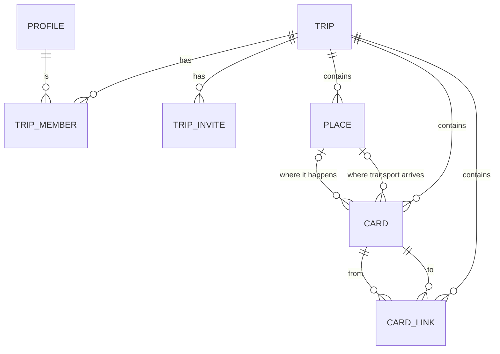
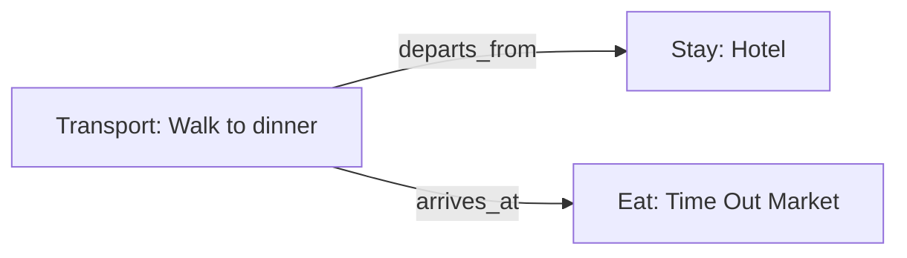
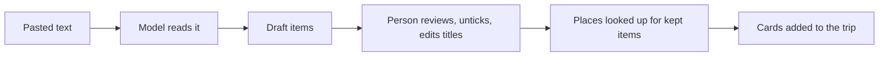

# Trip ontology

The concepts the app is built on, and how they relate. The code is the source of
truth: schemas in `packages/domain/src`, tables in `supabase/migrations`.

## Overview

A **trip** has **members**, **places** and **cards**. People join through
**invites**, and each person has a **profile**. A card is one intention in
the plan ("stay here", "eat there", "get from A to B"). A card may point at a
place. **Links** connect cards to each other.

The model keeps three things separate:

| Concept | Answers | Example |
|---|---|---|
| Place | Where is it? | Time Out Market, 38.7067, -9.1459 |
| Card | What do we intend to do? | Dinner at Time Out Market, Saturday 19:30, booked |
| Link | How do cards relate? | "Walk to dinner" departs from the hotel card |

One place can back several cards (two dinners at the same restaurant), and
routing and "what's nearby" work on places without caring about the plan.

## Trip

The container that people collaborate on.

| Field | Meaning |
|---|---|
| `title` | Name of the trip |
| `start_date`, `end_date` | Optional overall dates |
| `timezone` | Default zone for new cards |
| `created_by` | The user who created it; becomes the first owner |

## Trip member

A user's role in one trip.

| Role | Read | Add and edit content | Manage members | Delete trip |
|---|---|---|---|---|
| `owner` | Yes | Yes | Yes | Yes |
| `editor` | Yes | Yes | No | No |
| `viewer` | Yes | No | No | No |

Any member can remove themselves, except that a trip always keeps at least one
owner: the last owner cannot leave or step down. Non-members see nothing.

## Profile

How a user appears to others. Created automatically when someone first signs in.

| Field | Meaning |
|---|---|
| `display_name` | Starts as the part of their email before the @; theirs to change |

A profile is visible to its owner and to people who share a trip with them.

## Trip invite

A shareable link into a trip.

| Field | Meaning |
|---|---|
| `token` | The secret in the link |
| `role` | What the joiner becomes: `editor` or `viewer`, never `owner` |
| `expires_at` | Seven days after creation by default |
| `revoked_at` | Set when an owner turns the link off |

- Owners create, see and revoke invites.
- A link can be used by any number of people until it expires or is revoked.
- Anyone holding a link can see the trip's title and who invited them before
  signing in; joining requires signing in.
- Someone who is already a member keeps their current role.

## Place

A real-world location, independent of any plan to go there. A place belongs to
one trip.

| Field | Meaning |
|---|---|
| `name` | Display name |
| `lat`, `lng` | Coordinates |
| `address` | Optional free-text address |
| `timezone` | The place's own time zone, when the provider supplies it |
| `provider`, `provider_place_id` | Optional reference to an outside source (`google`, `mapbox`, `osm`); set together or not at all |

When a place comes from a provider, the provider's id is kept so details can be
refreshed rather than stored long-term.

## Card

One intention in a trip's plan. Every card has the same envelope, plus
`details` that depend on its kind.

### Kinds

| Kind | What it is | Kind-specific details |
|---|---|---|
| `stay` | Accommodation | `confirmation_code` |
| `eat` | Restaurant, cafe, bar | `meal`, `cuisine`, `party_size`, `confirmation_code` |
| `do` | Activity or sight | `category`, `confirmation_code` |
| `transport` | Getting from one place to another | `mode` (required), `carrier`, `service_number`, `confirmation_code`, `distance_meters`, `duration_seconds` |
| `note` | Free text with no place or booking | none |

- **Meals:** `breakfast`, `lunch`, `dinner`, `drinks`, `snack`
- **Transport modes:** `walk`, `bike`, `drive`, `taxi`, `transit`, `bus`, `train`, `ferry`, `flight`, `other`

Every `details` object carries a version number `v`, so its shape can change
later without rewriting existing cards.

### Envelope

| Field | Meaning |
|---|---|
| `title`, `notes`, `url` | What people see and write |
| `place_id` | Where it happens; for transport, where it departs from |
| `end_place_id` | Transport only: where it arrives |
| `start_date`, `start_time`, `start_tz` | When it starts, in local time with its zone |
| `end_date`, `end_time`, `end_tz` | When it ends, in local time with its zone |
| `status` | How firm the plan is |
| `origin`, `suggestion_state` | Where the card came from |
| `sort_key` | Position among other cards |

### Scheduling

- A card with no `start_date` is **unscheduled**: an idea not yet placed on a day.
- A date always comes with a time zone. A time is optional ("sometime on Saturday").
- Start and end each have their own zone, because a flight can leave in one zone
  and land in another.
- A card takes the zone of its place. Travel starts in the zone of the place it
  leaves from and ends in the zone of the place it arrives at. A card with no
  place uses the trip's zone.
- A card cannot end before it starts. The database compares the two as actual
  instants, so a flight may land earlier on the local clock than it left.

### Status

How firm the plan is. Independent of whether the card has a date.

| Status | Meaning |
|---|---|
| `idea` | Under consideration |
| `planned` | The group intends to do it |
| `booked` | Reserved or paid for |
| `done` | Happened |

### Origin and suggestions

| Origin | Meaning |
|---|---|
| `user` | A member created it |
| `suggestion` | The app proposed it |
| `import` | Brought in from elsewhere, such as a pasted itinerary |

A suggestion is an ordinary card. It also carries a `suggestion_state`:

| State | Meaning | Part of the plan? |
|---|---|---|
| `pending` | Waiting for someone to respond | No |
| `accepted` | A member accepted it | Yes |
| `dismissed` | A member rejected it | No |

`suggestion_state` is set exactly when `origin` is `suggestion`.

### Ordering

Cards are ordered by `sort_key`, a fractional index. Moving a card writes one
new key that sorts between its new neighbours; no other card changes. Two people
reordering at once therefore do not overwrite each other.

### How cards are shown

The same cards are arranged in three ways:

- **By day:** grouped by start date, with every day of the trip listed even if
  empty. Within a day, cards with a time come first in time order, then cards
  without a time in manual order. Cards with no date form a final group.
- **By kind:** grouped as stays, eats, things to do, travel and notes, each in
  manual order.

- **Map:** the places the plan uses, numbered in the order the trip reaches
  them, each with the cards there.

Pending and dismissed suggestions are left out of all three.

## Card link

A typed, directed relation between two cards in the same trip, read as
"*from card* **relation** *to card*".

| Relation | Meaning |
|---|---|
| `departs_from` | A transport card leaves from the other card's place |
| `arrives_at` | A transport card ends at the other card's place |

A transport card has at most one link of each relation. A card cannot link to
itself, and both ends must be in the same trip.

Example: walking from the hotel to dinner.

Transport has two ways to say where it goes, for two different situations:

- **Places** (`place_id`, `end_place_id`) for travel between fixed locations that
  are not themselves cards, such as a flight between two airports.
- **Links** for travel between two things already in the plan. If the hotel card
  moves to a different place, the walk still connects the right cards.

## Import

Turning a pasted itinerary into cards. Schemas and rules are in
`packages/domain/src/import.ts`.

Nothing is written to the trip until the last step.

### Draft item

What the model returns for each thing it finds. A draft is not a card: it has no
id, no trip and no place, only what the text said.

| Field | Meaning |
|---|---|
| `kind` | `stay`, `eat`, `do`, `transport`, or `note` for anything else worth keeping |
| `title`, `notes`, `url` | As on a card. A link is kept only if it appears in the pasted text |
| `day` | Day of the trip, counting from 1, when the text says "Day 2" |
| `date` | An explicit calendar date from the text |
| `start_time`, `end_time` | Clock times, only when the text gives them |
| `place_query` | A place name plus locality to search for |
| `end_place_query` | Transport only: where it arrives |
| `details` | `meal`, `cuisine`, `category`, `mode`, `carrier`, `service_number` |

Model output is untrusted. Each item is checked on its own; one that is not
valid is dropped and the rest are kept.

### From draft to card

| Card field | Rule |
|---|---|
| `origin`, `status` | Always `import` and `idea` |
| `sort_key` | After the trip's existing cards, in the order of the text |
| `start_date` | The explicit date if there is one. Otherwise day N is the trip's start date plus N − 1 (or a start date given at import time, if the trip has none). Otherwise unscheduled |
| `start_tz` | The zone of the card's place if it was found, otherwise the trip's zone |
| `end_date`, `end_tz` | Set when the text gives an end time. Same day as the start, or the next day if that would put the end before the start. Transport ends in the zone of the place it arrives at |
| `place_id`, `end_place_id` | The place found for each query, if any |
| `details` | Only the fields that belong to the card's kind. Transport with no clear mode gets `other` |

What a card cannot hold is kept in its notes: a day number or time on an
unscheduled card, and the name of a place that was not found.

A stay is imported on its first day only; the draft carries no check-out date.
Imports do not create card links.

### Places

Looking up a place costs money, so:

- Lookups happen only for items the person kept, when they confirm.
- Each distinct query is looked up once per import, up to 25. Beyond that, or
  when nothing matches, the card is added without a place.
- A place the trip already has is reused instead of being fetched again.

### Import run

A record of one import, for the daily limit and for seeing how the feature is
used. It holds sizes and counts, never the pasted text.

| Field | Meaning |
|---|---|
| `user_id`, `trip_id` | Who ran it and where. `trip_id` is cleared if the trip is deleted |
| `input_chars` | Length of the pasted text |
| `drafts_returned` | Items the model found. Empty if the model never answered |
| `cards_added`, `places_resolved` | Filled in when the person confirms |
| `model` | Which model read the text |

Only owners and editors can import. Each person can run 10 imports in any 24
hours; a run counts once the model has answered. A person can see their own runs.

## How suggestions use the model

Nothing below is built yet; it shows why the model has the shape it does.

- **Suggest travel:** find two consecutive scheduled cards at different places
  with no transport card linking them. Ask a routing service for the journey and
  add a `transport` card with `origin: suggestion`, linked to both.
- **Suggest somewhere to eat:** find a mealtime gap in a day, search for places
  near the cards on either side, and add `eat` cards with `origin: suggestion`.

In both cases members see normal cards they can accept or dismiss.

## Likely extensions

| Need | Where it fits |
|---|---|
| A new card kind, such as an event or a car rental | A new `kind` and `details` shape |
| Alternatives to vote between | A new link relation between cards |
| Grouping cards, such as a day trip | A new link relation between cards |
| Comments and votes | New tables that reference a card |
| Costs and splitting | New fields on the card envelope, or a table that references a card |
| Attachments, such as tickets | A new table that references a card |
